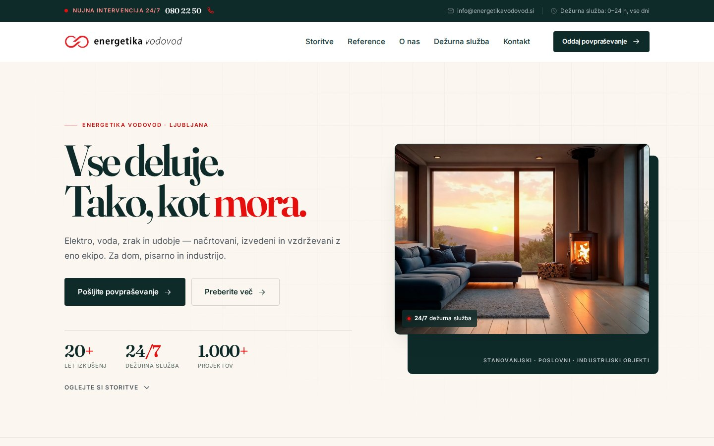
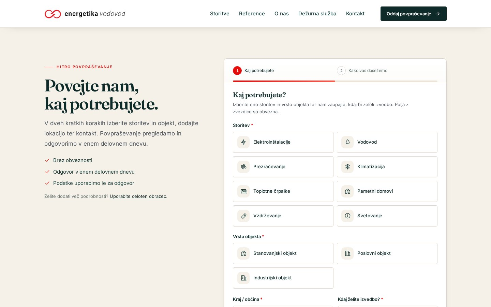
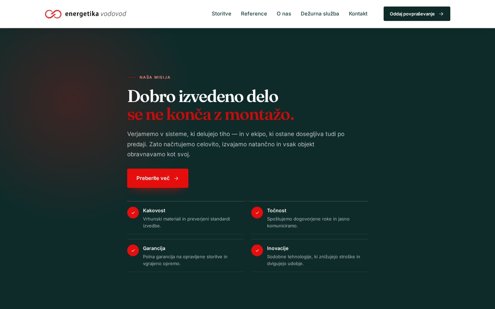
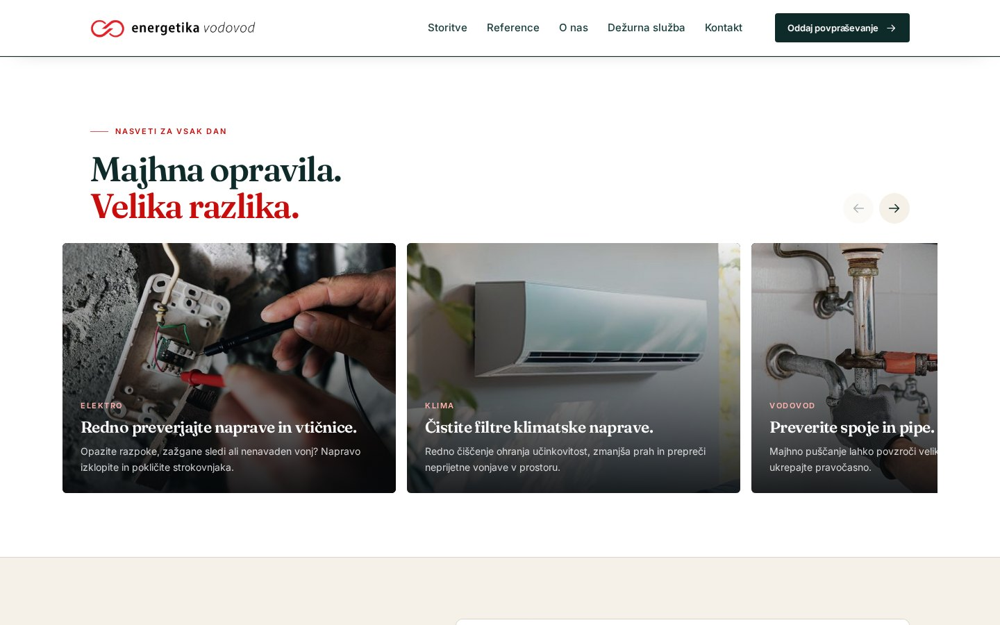
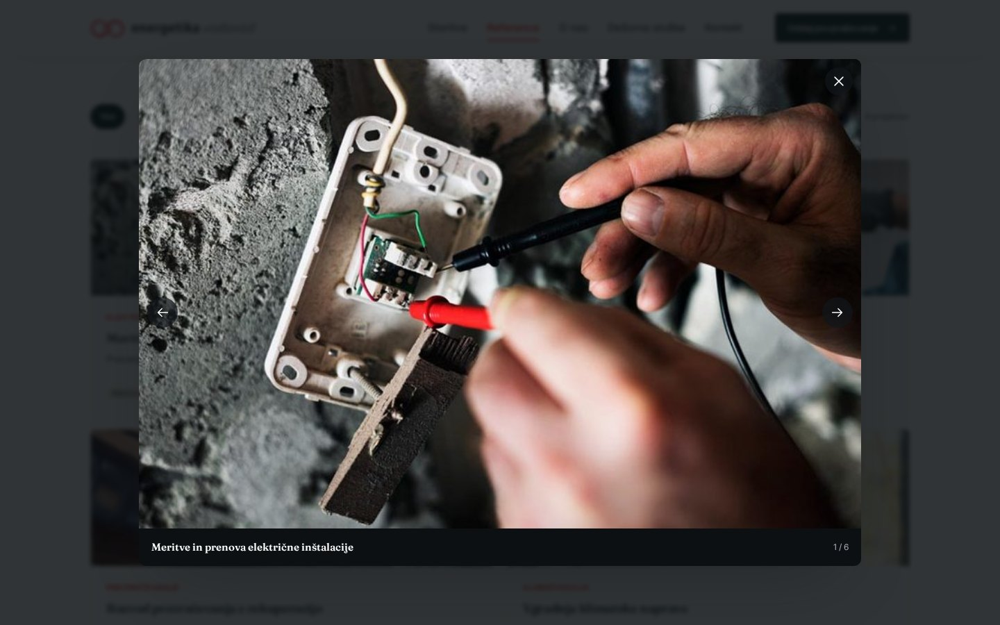

# Energetika Vodovod — multi-page website

A modern, responsive, multi-page website for **Energetika Vodovod d.o.o.** — *družba za izvajanje strokovnih nalog na področju energetike in vodovoda* — written in Slovenian.

Dependency-free static HTML, CSS and vanilla JS with eight dedicated service pages, clear navigation, readable long-form content, two inquiry forms with an e-mail fallback, and a consent-gated analytics setup.

**Live preview (current):** <https://mikey-dev404.github.io/energetika-vodovod-prototype/>  
**Repository:** <https://github.com/mikey-dev404/energetika-vodovod-prototype>

> **Private-repo migration:** Netlify config is prepared in `netlify.toml`; once the Netlify site is live, the GitHub repo can be switched to private and GitHub Pages disabled. Setup and verification: [`docs/netlify-private-preview.md`](docs/netlify-private-preview.md).



| Homepage inquiry | References |
| --- | --- |
|  |  |

| Mission section | Daily tips |
| --- | --- |
|  |  |

| Service page hero | Reference lightbox |
| --- | --- |
|  |  |

---

## Quick start

No build step, no `node_modules`.

```bash
cd energetika-vodovod-prototype
python3 -m http.server 4321
# open http://localhost:4321
```

Alternative servers:

```bash
npx serve .          # or: php -S localhost:4321
```

The services overview uses a folder URL (`/storitve/`); a local server handles this correctly. Opening files directly with `file://` breaks that link.

---

## Pages

| URL (production) | Page | Content |
| --- | --- | --- |
| `/` | **Domov** | Hero, eight services, why us, two-step inquiry, references, emergency band |
| `/storitve/` | **Storitve** | Eight services as a scannable index, process, contact note |
| `/storitve/elektroinstalacije.html` | Elektroinštalacije | Scope, process, FAQ, related services |
| `/storitve/vodovod.html` | Vodovod | Scope, process, FAQ, related services |
| `/storitve/prezracevanje.html` | Prezračevanje | Scope, process, FAQ, related services |
| `/storitve/klimatizacija.html` | Klimatizacija | Scope, process, FAQ, related services |
| `/storitve/toplotne-crpalke.html` | Toplotne črpalke | Scope, process, FAQ, related services |
| `/storitve/pametni-domovi.html` | Pametni domovi | Scope, process, FAQ, related services |
| `/storitve/vzdrzevanje.html` | Vzdrževanje | Four maintenance scopes, process, FAQ, related services |
| `/storitve/svetovanje.html` | Svetovanje | Planning, assessment, energy efficiency, maintenance plans |
| `/o-nas.html` | **O nas** | Company story, way of working, mission & vision, numbers, photo |
| `/reference.html` | **Reference** | Six selected photographs from the company’s work |
| `/dezurna-sluzba.html` | **Dežurna služba** | Emergency page, when to call, call process, safety note |
| `/kontakt.html` | **Kontakt** | Contact details and the full three-step inquiry form |
| `/zasebnost.html` | **Zasebnost** | Privacy policy, cookie settings and legal notice |

Every page shares the same emergency bar, header, footer and mobile action bar. The active page is highlighted, and inner pages include breadcrumbs.

---

## What’s included

- **Emergency line** — `080 22 50` (brezplačna številka) separated from navigation in the utility bar, with a fixed mobile action bar. Emergency scope and coverage are stated on the emergency page and home band.
- **Clear navigation** — five top-level items plus one inquiry CTA. The mobile menu has a backdrop, and only one header CTA exists in the DOM.
- **Home page** — editorial paper hero with the client’s film in a framed card, light service ticker, eight service cards, dark petrol mission/value split, daily-tips carousel, two-step guided inquiry and a closing emergency/contact band.
- **Eight service pages** — scope list, process steps, three FAQs in native `<details>` blocks, related services and a contact panel. The two restored live-site scopes are Vzdrževanje and Svetovanje.
- **Photo-led page heroes** — each service and content page opens with a light split hero: serif title on warm paper, work photography in a right-hand panel.
- **Photographic references** — six photographs from the company’s own website, with neutral captions, scope tags, category filters and an accessible lightbox. No invented locations, years or project metrics.
- **Contact page** — phone/e-mail/address/hours tiles, emergency strip and the full three-step form with live summary and confirmation.
- **Form handling** — both forms attempt to POST to the endpoint in `assets/js/form-config.js`; success is shown only on a real success response. **Verified 25 Nov 2026:** the FormSubmit AJAX endpoint is blocked by CORS from the GitHub Pages origin, so the forms currently fall back to a prefilled e-mail link instead of pretending to send. A CORS-enabled/server endpoint is required for automatic delivery.
- **Cookie consent** — first-visit banner with **Sprejmi vse**, **Zavrni vse** and **Nastavitve**, linked to `zasebnost.html#piskotki`. Google Tag Manager (`GTM-THRLMGMB`) is not requested until analytics consent is granted; Consent Mode v2 defaults to denied. See [`docs/cookie-consent.md`](docs/cookie-consent.md).
- **Migration / 301s** — legacy WordPress URLs (including `/vzdrzevanje/` and `/svetovanje/`) and existing clean URLs 301 to the new `.html` files. Clean URLs without `.html` require a folder-based restructure; the safe phase-2 plan is in [`docs/redirects.md`](docs/redirects.md).
- **Legal identifiers** — Matična številka `8167117000`, Davčna številka / ID za DDV `SI41527933`, Registrski organ Okrožno sodišče v Ljubljani, in the footer and privacy page.
- **SEO** — production canonical URLs, absolute Open Graph image, Twitter card, favicon set, web manifest, `LocalBusiness` JSON-LD with opening hours, `sitemap.xml` and `robots.txt`.
- **Rebrand** — warm paper, deep petrol, signal red; Fraunces display serif + Inter; sharp editorial controls. Deliberately distinct from the live WordPress site while keeping the client’s logo, photography, video and content.
- **Living details** — animated counters, a scroll progress bar, back-to-top control, a daily-tips carousel, filterable references and a keyboard-accessible lightbox. All motion respects `prefers-reduced-motion`.
- **Readable typography** — 17 px body, 1.7 line-height, prose limited to ~68 characters.
- **Accessibility** — 0 axe violations on all 15 pages; semantic landmarks, one `h1`, visible breadcrumbs, labelled fields, `aria-invalid`/`role="alert"` errors, focus management, reduced-motion and print styles.

---

## Project structure

```
energetika-vodovod-prototype/
├── index.html
├── o-nas.html
├── reference.html
├── dezurna-sluzba.html
├── kontakt.html
├── zasebnost.html
├── storitve/
│   ├── index.html
│   ├── elektroinstalacije.html
│   ├── vodovod.html
│   ├── prezracevanje.html
│   ├── klimatizacija.html
│   ├── toplotne-crpalke.html
│   ├── pametni-domovi.html
│   ├── vzdrzevanje.html
│   └── svetovanje.html
├── assets/
│   ├── css/                   # fonts.css + style.css
│   ├── js/
│   │   ├── form-config.js     # form endpoint configuration
│   │   ├── consent.js         # cookie banner + GTM gate
│   │   ├── enhancements.js    # counters, filters, lightbox, scroll UI
│   │   ├── main.js            # navigation, contact wizard, shared UI
│   │   └── home-lead.js       # compact homepage inquiry
│   ├── fonts/                 # Fraunces + Inter woff2 + OFL licences
│   └── img/                   # logo, hero poster, gallery, favicons, OG image
├── docs/                      # previews + migration/verification notes
├── _redirects                 # Netlify legacy 301s
├── .htaccess                  # Apache/LiteSpeed equivalent
├── sitemap.xml
├── robots.txt
├── site.webmanifest
├── .nojekyll
└── README.md
```

Each HTML file is standalone and includes its own copy of the shared header and footer. There is no build step; hand-edit the HTML/CSS/JS directly.

---

## Forms

Both forms attempt to POST JSON to the endpoint in `assets/js/form-config.js`:

```js
window.EV_FORM_CONFIG = {
  endpoint: 'https://formsubmit.co/ajax/info@energetikavodovod.si',
  fallbackEmail: 'info@energetikavodovod.si'
};
```

**Live verification (25 Nov 2026):** See [`docs/form-verification.md`](docs/form-verification.md). A real submission from the deployed GitHub Pages site to `https://formsubmit.co/ajax/info@energetikavodovod.si` failed in the browser with a CORS error (no `Access-Control-Allow-Origin`). The form did **not** show a false success; it displayed the error state and a prefilled `mailto:` fallback. A standard FormSubmit POST was also tested and hit a Cloudflare challenge. **FormSubmit AJAX is therefore not a usable production handler from this origin.**

**To make automatic delivery work**, point `endpoint` at a CORS-enabled endpoint you control — e.g. a same-origin `send.php`/PHP handler on the production hosting, a Formspree form ID, or Netlify Forms. The UI is already wired for a JSON/2xx success response and an error + e-mail fallback. The payload contains `_subject`, `_template`, `name`, `phone`, `email`, `service`, `property`, `location`, `urgency`, `message`, `consent` and `_replyto`.

**Activation:** if you do use FormSubmit, the recipient (`info@energetikavodovod.si`) must confirm the first submission via the activation e-mail. That does not remove the CORS blocker observed from GitHub Pages.

**Privacy:** FormSubmit is a third-party processor; the fallback uses the visitor's e-mail client. This is disclosed in `zasebnost.html`. Review the DPA/GDPR position before launch. The consent checkbox blocks submission in both forms.

---

## Cookie consent

The first-visit banner offers **Sprejmi vse**, **Zavrni vse** and **Nastavitve**, with a link to `zasebnost.html#piskotki`. Google Tag Manager (`GTM-THRLMGMB`) and Google Analytics are **not loaded until analytics consent is granted**; Consent Mode v2 defaults to denied. The choice is stored under `ev-cookie-consent-v1` and expires after 365 days. Withdrawing consent after GTM has loaded triggers one reload so the tag is not re-used. Marketing and external-content categories exist but have no loaders because no Meta Pixel or maps are present.

Configuration and testing: [`docs/cookie-consent.md`](docs/cookie-consent.md).

---

## Customising

**Contacts** — phone numbers, e-mail and address appear in the shared header/footer, contact page, privacy page and mobile bar. Emergency line: `080 22 50`; office: `+386 1 582 40 21`; mobile: `+386 40 599 474`.

**Services** — each service has its own file under `storitve/` (scope, steps, FAQs, related services). To add a ninth service, copy a file, update the content, then add it to `storitve/index.html`, the footer, the homepage and both Step 1 service grids.

**References** — `reference.html` and the three cards on the home page use photographs from the company’s own site with neutral captions and scope tags (e.g. Meritve, Prenova inštalacije, Rekuperacija). Replace them with documented project photos and details when available; do not add locations, years or metrics without verification.

**Trust signals** — the site currently uses verified numbers (20+ years, 1,000+ projects, 24/7), service breadth and photographic references. Partner/manufacturer logos, certifications and client reviews should be added only with client-supplied, verifiable assets.

**Legal** — company identifiers are in the footer and `zasebnost.html`. They were checked on 25 Nov 2026 against VIES and an AJPES-sourced CompanyWall record; see [`docs/registry-verification.md`](docs/registry-verification.md). Keep the evidence and have the legal wording reviewed before launch.

**Cache busting** — CSS and JS are linked with `?v=20261125e`. After editing CSS/JS, update that string in every HTML file.

---

## SEO & deployment

- Canonical URLs, `og:url`, absolute `og:image` and sitemap use the production domain `https://energetikavodovod.si`. Service and content canonicals use the actual `.html` files (the home page is `/` and the services index is `/storitve/`).
- `sitemap.xml` and `robots.txt` are ready for the production root.
- The GitHub Pages preview lives under `/energetika-vodovod-prototype/`. Logo links use `./` / `../` so they resolve to the site root on both the preview and the production domain. Canonicals point to production.
- When deploying to the production domain, upload the repository contents to the web root and activate the 301 rules in [`.htaccess`](.htaccess) or [`_redirects`](_redirects). The existing WordPress site already uses clean paths; the 301s map them to the new `.html` files. See [`docs/redirects.md`](docs/redirects.md).
- **GitHub Pages:** already enabled; every push to `main` redeploys.
- **Netlify:** publish directory = project root; no build command.

### Before launch

- [ ] Deploy a CORS-enabled endpoint (same-origin `send.php` or a Formspree/Netlify form ID) and retest both forms. FormSubmit AJAX is currently CORS-blocked from GitHub Pages.
- [ ] Confirm emergency coverage (`Ljubljana z okolico` is currently stated) and toll-free status with the client.
- [x] Registry data checked 25 Nov 2026: MŠ `8167117000` and DŠ `SI41527933` via VIES and the AJPES-sourced CompanyWall record; Reg. organ `Okrožno sodišče v Ljubljani` via the same AJPES-sourced record. Retain the evidence with the launch file.
- [ ] Replace the service-photo gallery with documented project references and add partner logos/certifications/reviews.
- [ ] Have the privacy policy and consent wording reviewed for GDPR/ZEKom-2.
- [x] Cookie consent banner added and GTM gated behind analytics consent. Confirm the GTM container (`GTM-THRLMGMB`), Consent Mode tags, Google DPA and retention settings with the client.
- [ ] Test the legacy 301s on the production host (see `docs/redirects.md`). Clean URLs remain a later folder-based phase.
- [ ] Verify canonical URLs and redirects after the production deployment.

---

## Ownership & copyright

Copyright © 2026 **mikey-dev404** (replace with your legal name/company). The source code, structure and design implementation are proprietary; see [`LICENSE`](LICENSE). Client brand assets — the Energetika Vodovod name, logo, photography, video and copy — remain the client’s property and are excluded from that claim.

Practical protection and a Slovenian contract clause template: [`docs/ip-and-copyright.md`](docs/ip-and-copyright.md). The signed development agreement, not the repo visibility, is the main legal ground. `MANIFEST.sha256` records the source hashes at the tagged commit.

---

## Git

```bash
git add .
git commit -m "Production readiness: forms, legal, SEO and content fixes"
git push origin main
```

---

Content and brand assets belong to Energetika Vodovod d.o.o.
