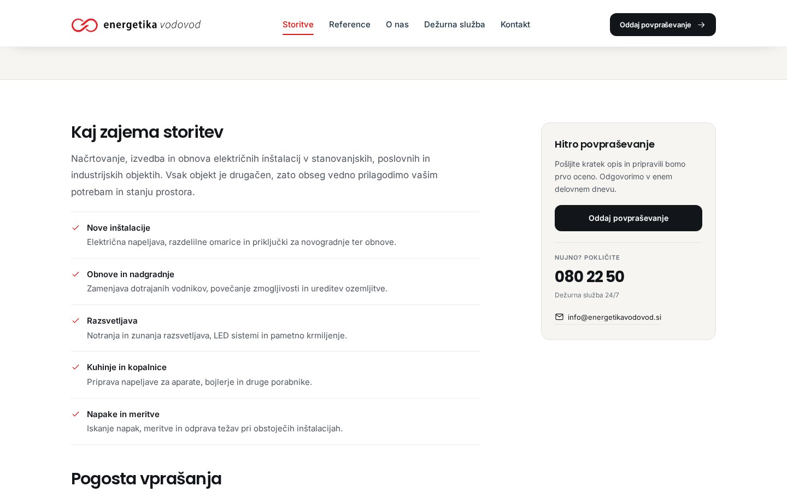
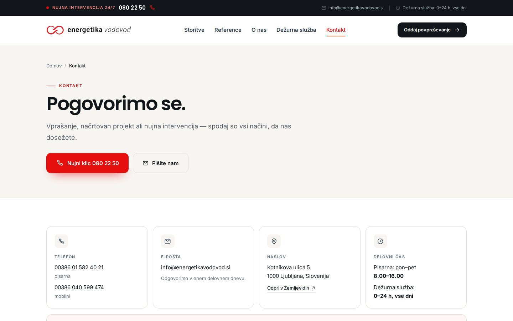

# Energetika Vodovod — multi-page website prototype

A modern, responsive, multi-page prototype for **Energetika Vodovod d.o.o.** — *družba za izvajanje strokovnih nalog na področju energetike in vodovoda* — written in Slovenian.

Built as a dependency-free static site (HTML + CSS + vanilla JS), with a dedicated page for each service, clear navigation, breadcrumbs and readable long-form content. It can be previewed instantly, dropped on any static host, or used as a design reference for the existing WordPress/Divi site.

**Live preview:** <https://mikey-dev404.github.io/energetika-vodovod-prototype/>  
**Repository:** <https://github.com/mikey-dev404/energetika-vodovod-prototype>


| Service detail page | Contact & inquiry |
| --- | --- |
|  |  |

---

## Quick start

No build step, no `node_modules`.

```bash
cd energetika-vodovod-prototype
python3 -m http.server 4321
# open http://localhost:4321
```

Alternative servers:

```bash
npx serve .          # or: php -S localhost:4321
```

The services overview uses a folder URL (`/storitve/`). A local server handles this correctly; opening files directly via `file://` breaks that link, so use one of the commands above.

---

## Pages

| URL | Page | Content |
| --- | --- | --- |
| `/` | **Domov** | Hero, six services, why us, three references, emergency band |
| `/storitve/` | **Storitve** | Six services as a scannable index, process, contact note |
| `/storitve/elektroinstalacije.html` | Elektroinštalacije | Scope, process, FAQ, related services |
| `/storitve/vodovod.html` | Vodovod | Scope, process, FAQ, related services |
| `/storitve/prezracevanje.html` | Prezračevanje | Scope, process, FAQ, related services |
| `/storitve/klimatizacija.html` | Klimatizacija | Scope, process, FAQ, related services |
| `/storitve/toplotne-crpalke.html` | Toplotne črpalke | Scope, process, FAQ, related services |
| `/storitve/pametni-domovi.html` | Pametni domovi | Scope, process, FAQ, related services |
| `/o-nas.html` | **O nas** | Company story, way of working, mission & vision, numbers, photo |
| `/reference.html` | **Reference** | Six clearly marked sample projects |
| `/dezurna-sluzba.html` | **Dežurna služba** | Emergency page, when to call, call process, safety note |
| `/kontakt.html` | **Kontakt** | Full contact details and the guided inquiry form |
| `/zasebnost.html` | **Varstvo podatkov** | Placeholder privacy & cookie information |

Every page shares the same emergency bar, header, footer and mobile action bar. The active page is highlighted in the navigation, and inner pages include breadcrumbs.

---

## What’s included

- **Emergency line always separated** — slim dark bar with `Nujna intervencija 24/7 · 080 22 50` above the navigation, plus a fixed mobile bar.
- **Clear navigation** — five top-level items (Storitve, Reference, O nas, Dežurna služba, Kontakt) and one persistent inquiry CTA. The mobile menu has a backdrop and its own inquiry button.
- **Home page** — concise hero, six service cards linking to detail pages, trust band, three references and a compact emergency/contact band.
- **Storitve overview** — six services as full-width rows with icons and short descriptions, a three-step process and a “something else?” note.
- **Six service pages** — each with a page hero, scope list, process steps, three FAQs in accessible `<details>` blocks, related services and a contact panel.
- **Reference page** — six `Vzorčni vnos` cards with a clear disclaimer.
- **About page** — story, working principles, mission/vision, numbers and a real photo.
- **Emergency page** — dedicated red hero, “when to call”, call process, preparation checklist and a 112 safety note.
- **Contact page** — phone/e-mail/address/hours tiles, emergency strip and the full three-step inquiry form with live summary and confirmation screen.
- **Readable typography** — 17 px body, 1.7 line-height, prose limited to ~68 characters, generous spacing, sentence-case headings and darker body text.
- **Accessibility** — axe-clean on all pages, semantic landmarks, one `h1` per page, breadcrumbs, labelled forms, focus management, `prefers-reduced-motion`, print styles.
- **Details** — sticky header, subtle scroll reveals, SVG icon sprite, self-hosted Poppins/Inter fonts, WebP hero with JPEG fallback, JSON-LD `LocalBusiness` on the home page.

---

## Project structure

```
energetika-vodovod-prototype/
├── index.html
├── o-nas.html
├── reference.html
├── dezurna-sluzba.html
├── kontakt.html
├── zasebnost.html
├── storitve/
│   ├── index.html
│   ├── elektroinstalacije.html
│   ├── vodovod.html
│   ├── prezracevanje.html
│   ├── klimatizacija.html
│   ├── toplotne-crpalke.html
│   └── pametni-domovi.html
├── assets/
│   ├── css/
│   │   ├── fonts.css          # self-hosted @font-face (latin + latin-ext)
│   │   └── style.css          # design tokens + all components
│   ├── js/
│   │   └── main.js            # header, mobile menu, reveal, inquiry wizard
│   ├── fonts/                 # Poppins + Inter woff2
│   └── img/                   # logo, hero, about photo, icon, OG cover
├── docs/                      # README preview images
├── .nojekyll
└── README.md
```

There is intentionally **no build step**. Each HTML file is standalone and includes its own copy of the shared header and footer, so the site works on any static host and is easy to hand-edit. If you change a phone number or a navigation label, update it across the HTML files (search & replace).

---

## Brand & design system

The palette, logo and typography follow the existing brand at [energetikavodovod.si](https://www.energetikavodovod.si):

| Token | Value | Usage |
| --- | --- | --- |
| `--red` | `#e60f0e` | primary accent, CTAs, links |
| `--red-600` | `#c90d0c` | small red text, eyebrows |
| `--red-700` | `#a80b0a` | hover / gradient end |
| `--ink` | `#12161a` | headlines, dark sections |
| `--ink-2` | `#1c3144` | brand navy |
| `--surface` | `#f7f5f2` | warm section background |
| Headings | Poppins 600 | tight tracking |
| Body | Inter 400–600 | 17 px, 1.7 line-height |

All tokens live at the top of `assets/css/style.css` (`:root`). Changing `--red` and `--ink` re-skins the whole site.

Logos (`assets/img/logo.png`, `logo-white.png`) come from the live site; the favicon uses the existing icon mark.

---

## Customising

**Contacts** — the emergency number, office phone, mobile, e-mail and website appear in the shared header/footer, on the contact page and in the mobile bar. Search for `080 22 50`, `582 40 21`, `040 599 474` and `info@energetikavodovod.si` across the HTML files.

**Services** — each service has its own file under `storitve/` with:

- a page hero (title + intro),
- a **Kaj zajema storitev** list,
- **Kako poteka sodelovanje** steps,
- **Pogosta vprašanja** (`<details>` blocks),
- three related services.

To add a seventh service, copy one file, update its content, then add it to the services overview and to the footer of every page.

**References** — all six cards on `reference.html` (and the three on the home page) are marked `Vzorčni vnos`. Replace photos, titles, locations, years and metrics. The three home cards are a subset — update both files.

**Inquiry form** — lives on `kontakt.html` (`#povprasevanje`). The prototype deliberately does **not** send data anywhere. On submit, `submitInquiry()` in `assets/js/main.js` simulates a request, builds the success summary and stores the last 10 submissions in `localStorage` (`ev-prototype-inquiries`). Replace the `setTimeout` block with your endpoint:

```js
const response = await fetch('https://formspree.io/f/XXXX', {
  method: 'POST',
  headers: { 'Content-Type': 'application/json', 'Accept': 'application/json' },
  body: JSON.stringify(data)
});
```

Then remove the prototype note from the success panel and align the consent text with your privacy policy.

**Legal pages** — `zasebnost.html` is a clearly marked placeholder. Replace it with a reviewed privacy/cookie policy before launch. Footer legal links already point to it.

---

## Accessibility & performance notes

- `axe-core` reports **0 violations** on all 13 pages (WCAG 2 A/AA + best practice).
- Semantic landmarks, one `h1` per page, visible breadcrumbs, skip link and visible focus rings.
- Form: fieldsets/legends, labels for every field, `aria-invalid`, `role="alert"` errors, live step announcements through focus management and keyboard-friendly radio cards.
- FAQ uses native `<details>`/`<summary>`; no extra JavaScript.
- `prefers-reduced-motion` disables reveals and smooth scrolling; print CSS keeps content visible.
- No frameworks, no tracking, no external requests. Fonts and images are local; the whole site is roughly 1.3 MB including all pages, fonts and photos.
- Mobile inputs use 16 px type to avoid iOS auto-zoom; touch targets are at least 44 px.

---

## Deploy

**GitHub Pages** — already enabled: <https://mikey-dev404.github.io/energetika-vodovod-prototype/>. Every push to `main` redeploys automatically.

**Netlify / Vercel** — drag the folder into Netlify Drop, or set the publish directory to the project root. No build command needed.

**Existing WordPress site** — the layout maps cleanly to Divi/Elementor templates; use the design tokens above as the reference.

---

## Before launch — checklist

- [ ] Replace sample references with real projects and photos (home + reference page).
- [ ] Connect the inquiry form to e-mail/CRM and test the success state.
- [ ] Replace the placeholder privacy page and align the consent wording with GDPR.
- [ ] Confirm the claims used in copy: 20+ years, 1.000+ projects, response time “1 delovni dan”.
- [ ] Review service copy with the technical team (scope, typical timelines, what is not included).
- [ ] Add a cookie consent banner if analytics/marketing scripts are introduced.
- [ ] Set an absolute `og:image` URL once the production domain is known.
- [ ] Test the navigation and form with real content lengths (long project names, two-line addresses).

---

## Git

```bash
git init
git add .
git commit -m "Energetika Vodovod multi-page website prototype"
git branch -M main
gh repo create energetika-vodovod-prototype --public --source=. --remote=origin --push
```

Or with an existing remote:

```bash
git remote add origin git@github.com:<username>/energetika-vodovod-prototype.git
git push -u origin main
```

---

Prototype only — content, references and the inquiry form are demonstrational. Brand assets and contact details belong to Energetika Vodovod d.o.o.
