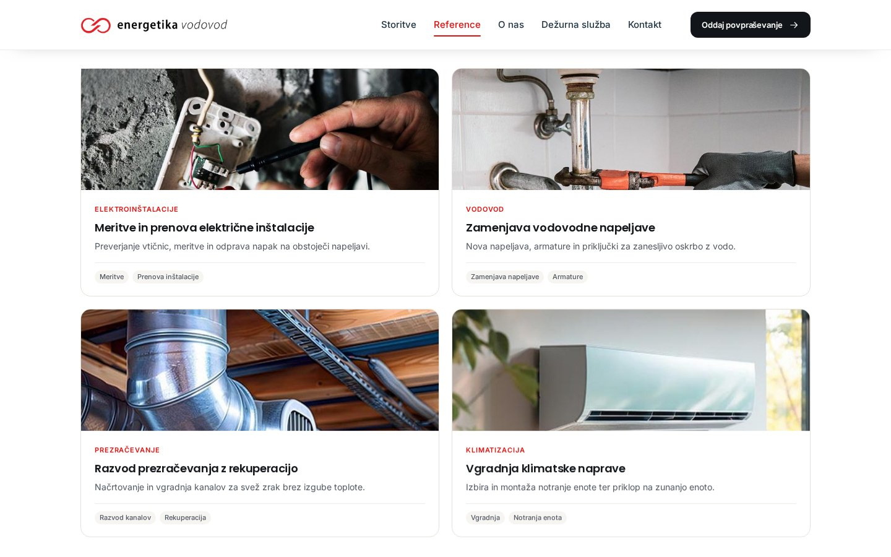

# Energetika Vodovod — multi-page website

A modern, responsive, multi-page website for **Energetika Vodovod d.o.o.** — *družba za izvajanje strokovnih nalog na področju energetike in vodovoda* — written in Slovenian.

Dependency-free static HTML, CSS and vanilla JS with dedicated service pages, clear navigation, readable long-form content and two working inquiry forms.

**Live preview:** <https://mikey-dev404.github.io/energetika-vodovod-prototype/>  
**Repository:** <https://github.com/mikey-dev404/energetika-vodovod-prototype>


| Homepage inquiry | References |
| --- | --- |
|  |  |

---

## Quick start

No build step, no `node_modules`.

```bash
cd energetika-vodovod-prototype
python3 -m http.server 4321
# open http://localhost:4321
```

Alternative servers:

```bash
npx serve .          # or: php -S localhost:4321
```

The services overview uses a folder URL (`/storitve/`); a local server handles this correctly. Opening files directly with `file://` breaks that link.

---

## Pages

| URL (production) | Page | Content |
| --- | --- | --- |
| `/` | **Domov** | Hero, six services, why us, two-step inquiry, references, emergency band |
| `/storitve/` | **Storitve** | Six services as a scannable index, process, contact note |
| `/storitve/elektroinstalacije/` | Elektroinštalacije | Scope, process, FAQ, related services |
| `/storitve/vodovod/` | Vodovod | Scope, process, FAQ, related services |
| `/storitve/prezracevanje/` | Prezračevanje | Scope, process, FAQ, related services |
| `/storitve/klimatizacija/` | Klimatizacija | Scope, process, FAQ, related services |
| `/storitve/toplotne-crpalke/` | Toplotne črpalke | Scope, process, FAQ, related services |
| `/storitve/pametni-domovi/` | Pametni domovi | Scope, process, FAQ, related services |
| `/o-nas/` | **O nas** | Company story, way of working, mission & vision, numbers, photo |
| `/reference/` | **Reference** | Six selected photographs from the company’s work |
| `/dezurna-sluzba/` | **Dežurna služba** | Emergency page, when to call, call process, safety note |
| `/kontakt/` | **Kontakt** | Contact details and the full three-step inquiry form |
| `/varstvo-osebnih-podatkov/` | **Zasebnost** | Privacy policy, cookies and legal notice |

Every page shares the same emergency bar, header, footer and mobile action bar. The active page is highlighted, and inner pages include breadcrumbs.

---

## What’s included

- **Emergency line** — `080 22 50` (brezplačna številka) separated from navigation in the utility bar, with a fixed mobile action bar. Emergency scope and coverage are stated on the emergency page and home band.
- **Clear navigation** — five top-level items plus one inquiry CTA. The mobile menu has a backdrop, and only one header CTA exists in the DOM.
- **Home page** — hero (all six services), service cards, trust band, a two-step guided inquiry with instant confirmation, three reference photographs and a closing emergency/contact band.
- **Six service pages** — scope list, process steps, three FAQs in native `<details>` blocks, related services and a contact panel.
- **Photographic references** — images from the company’s own website, used with neutral service captions. No invented locations, years or project metrics.
- **Contact page** — phone/e-mail/address/hours tiles, emergency strip and the full three-step form with live summary and confirmation.
- **Form handling** — both forms attempt to POST to the endpoint in `assets/js/form-config.js`; success is shown only on a real success response. **Verified 25 Nov 2026:** the FormSubmit AJAX endpoint is blocked by CORS from the GitHub Pages origin, so the forms currently fall back to a prefilled e-mail link instead of pretending to send. A CORS-enabled/server endpoint is required for automatic delivery.
- **Legal identifiers** — Matična številka `8167117000`, Davčna številka / ID za DDV `SI41527933`, Registrski organ Okrožno sodišče v Ljubljani, in the footer and privacy page.
- **SEO** — production canonical URLs, absolute Open Graph image, Twitter card, favicon set, web manifest, `LocalBusiness` JSON-LD with opening hours, `sitemap.xml` and `robots.txt`.
- **Readable typography** — 17 px body, 1.7 line-height, prose limited to ~68 characters.
- **Accessibility** — 0 axe violations on all 13 pages; semantic landmarks, one `h1`, visible breadcrumbs, labelled fields, `aria-invalid`/`role="alert"` errors, focus management, reduced-motion and print styles.

---

## Project structure

```
energetika-vodovod-prototype/
├── index.html
├── o-nas.html
├── reference.html
├── dezurna-sluzba.html
├── kontakt.html
├── zasebnost.html
├── storitve/
│   ├── index.html
│   ├── elektroinstalacije.html
│   ├── vodovod.html
│   ├── prezracevanje.html
│   ├── klimatizacija.html
│   ├── toplotne-crpalke.html
│   └── pametni-domovi.html
├── assets/
│   ├── css/                   # fonts.css + style.css
│   ├── js/
│   │   ├── form-config.js     # form endpoint configuration
│   │   ├── main.js            # navigation, contact wizard, shared UI
│   │   └── home-lead.js       # compact homepage inquiry
│   ├── fonts/                 # Poppins + Inter woff2
│   └── img/                   # logo, hero collage, gallery, favicons, OG image
├── docs/                      # README preview images
├── sitemap.xml
├── robots.txt
├── site.webmanifest
├── .nojekyll
└── README.md
```

Each HTML file is standalone and includes its own copy of the shared header and footer. There is no build step; hand-edit the HTML/CSS/JS directly.

---

## Forms

Both forms attempt to POST JSON to the endpoint in `assets/js/form-config.js`:

```js
window.EV_FORM_CONFIG = {
  endpoint: 'https://formsubmit.co/ajax/info@energetikavodovod.si',
  fallbackEmail: 'info@energetikavodovod.si'
};
```

**Live verification (25 Nov 2026):** See [`docs/form-verification.md`](docs/form-verification.md). A real submission from the deployed GitHub Pages site to `https://formsubmit.co/ajax/info@energetikavodovod.si` failed in the browser with a CORS error (no `Access-Control-Allow-Origin`). The form did **not** show a false success; it displayed the error state and a prefilled `mailto:` fallback. A standard FormSubmit POST was also tested and hit a Cloudflare challenge. **FormSubmit AJAX is therefore not a usable production handler from this origin.**

**To make automatic delivery work**, point `endpoint` at a CORS-enabled endpoint you control — e.g. a same-origin `send.php`/PHP handler on the production hosting, a Formspree form ID, or Netlify Forms. The UI is already wired for a JSON/2xx success response and an error + e-mail fallback. The payload contains `_subject`, `_template`, `name`, `phone`, `email`, `service`, `property`, `location`, `urgency`, `message`, `consent` and `_replyto`.

**Activation:** if you do use FormSubmit, the recipient (`info@energetikavodovod.si`) must confirm the first submission via the activation e-mail. That does not remove the CORS blocker observed from GitHub Pages.

**Privacy:** FormSubmit is a third-party processor; the fallback uses the visitor's e-mail client. This is disclosed in `zasebnost.html`. Review the DPA/GDPR position before launch. The consent checkbox blocks submission in both forms.

---

## Customising

**Contacts** — phone numbers, e-mail and address appear in the shared header/footer, contact page, privacy page and mobile bar. Emergency line: `080 22 50`; office: `+386 1 582 40 21`; mobile: `+386 40 599 474`.

**Services** — each service has its own file under `storitve/` (scope, steps, FAQs, related services). To add a seventh service, copy a file, update the content, then add it to `storitve/index.html`, the footer and the homepage.

**References** — `reference.html` and the three cards on the home page use photographs from the company’s own site with neutral captions and scope tags (e.g. Meritve, Prenova inštalacije, Rekuperacija). Replace them with documented project photos and details when available; do not add locations, years or metrics without verification.

**Trust signals** — the site currently uses verified numbers (20+ years, 1,000+ projects, 24/7), service breadth and photographic references. Partner/manufacturer logos, certifications and client reviews should be added only with client-supplied, verifiable assets.

**Legal** — company identifiers are in the footer and `zasebnost.html`. They were checked on 25 Nov 2026 against VIES and an AJPES-sourced CompanyWall record; see [`docs/registry-verification.md`](docs/registry-verification.md). Keep the evidence and have the legal wording reviewed before launch.

**Cache busting** — CSS and JS are linked with `?v=20261125c`. After editing CSS/JS, update that string in every HTML file.

---

## SEO & deployment

- Canonical URLs, `og:url`, absolute `og:image` and sitemap use the production domain `https://energetikavodovod.si`.
- `sitemap.xml` and `robots.txt` are ready for the production root.
- The GitHub Pages preview lives under `/energetika-vodovod-prototype/`. Logo links use `./` / `../` so they resolve to the site root on both the preview and the production domain. Canonicals point to production.
- When deploying to the production domain, upload the repository contents to the web root and ensure the clean URLs in the sitemap resolve (the existing WordPress site already uses `/storitve/.../` paths).
- **GitHub Pages:** already enabled; every push to `main` redeploys.
- **Netlify:** publish directory = project root; no build command.

### Before launch

- [ ] Deploy a CORS-enabled endpoint (same-origin `send.php` or a Formspree/Netlify form ID) and retest both forms. FormSubmit AJAX is currently CORS-blocked from GitHub Pages.
- [ ] Confirm emergency coverage (`Ljubljana z okolico` is currently stated) and toll-free status with the client.
- [x] Registry data checked 25 Nov 2026: MŠ `8167117000` and DŠ `SI41527933` via VIES and the AJPES-sourced CompanyWall record; Reg. organ `Okrožno sodišče v Ljubljani` via the same AJPES-sourced record. Retain the evidence with the launch file.
- [ ] Replace the service-photo gallery with documented project references and add partner logos/certifications/reviews.
- [ ] Have the privacy policy and consent wording reviewed for GDPR/ZEKom-2.
- [ ] If analytics/maps are added, implement a cookie consent banner before loading them.
- [ ] Verify canonical URLs and redirects after the production deployment.

---

## Git

```bash
git add .
git commit -m "Production readiness: forms, legal, SEO and content fixes"
git push origin main
```

---

Content and brand assets belong to Energetika Vodovod d.o.o.
