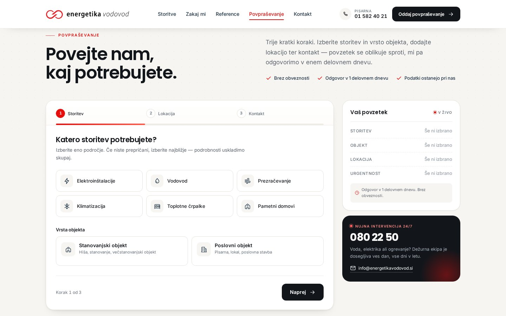
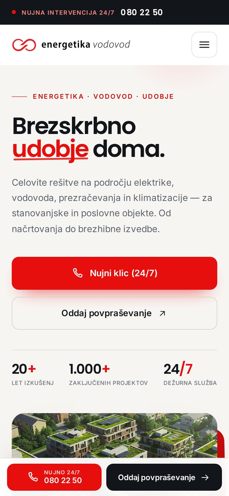

# Energetika Vodovod — landing page prototype

A modern, responsive, single-page prototype for **Energetika Vodovod d.o.o.** — *družba za izvajanje strokovnih nalog na področju energetike in vodovoda* — written in Slovenian.

Built as a dependency-free static site (HTML + CSS + vanilla JS) so it can be previewed instantly, dropped on any static host, or used as a design reference for the existing WordPress/Divi site.

**Live preview:** <https://mikey-dev404.github.io/energetika-vodovod-prototype/>  
**Repository:** <https://github.com/mikey-dev404/energetika-vodovod-prototype>


| Guided inquiry form | Mobile |
| --- | --- |
|  |  |

---

## Quick start

No build step, no `node_modules`.

```bash
cd energetika-vodovod-prototype
python3 -m http.server 4321
# open http://localhost:4321
```

Alternative servers:

```bash
npx serve .          # or: php -S localhost:4321
```

Opening `index.html` directly with `file://` also works in most browsers, but a local server is recommended so the self-hosted fonts and WebP image load with the correct headers.

---

## What is included

- **Emergency line separated from navigation** — a slim dark utility bar with `Nujna intervencija 24/7 · 080 22 50`, kept apart from the main nav and the inquiry CTA.
- **Hero** — “Brezskrbno udobje doma.” value proposition, primary CTA `Nujni klic (24/7)` and secondary `Oddaj povpraševanje`, plus trust stats (20+ let, 1.000+ projektov, 24/7).
- **Six core services** — Elektroinštalacije, Vodovod, Prezračevanje, Klimatizacija, Toplotne črpalke, Pametni domovi. Clicking a card pre-selects that service in the form.
- **Guided 3-step inquiry form** — service → location/urgency → contacts, with inline validation, a live summary panel, and an instant confirmation screen with a generated reference number.
- **Reference showcase** — four clearly marked `Vzorčni vnos` cards with category filters and a short disclaimer.
- **Emergency call band** and **full footer** with address, office phone, mobile, e-mail, emergency number and service links.
- **Responsive layout** — desktop, tablet, mobile; fixed mobile action bar (`Nujni klic` + `Oddaj povpraševanje`).
- **Details** — sticky header with scroll spy, scroll reveals, marquee, keyboard-friendly controls, `prefers-reduced-motion` support, print styles, SVG icon sprite, self-hosted Poppins/Inter fonts, WebP hero with JPEG fallback, JSON-LD `LocalBusiness` data.

---

## Project structure

```
energetika-vodovod-prototype/
├── index.html
├── assets/
│   ├── css/
│   │   ├── fonts.css          # self-hosted @font-face (latin + latin-ext)
│   │   └── style.css          # design tokens + all components
│   ├── js/
│   │   └── main.js            # navigation, scroll spy, filters, inquiry wizard
│   ├── fonts/                 # Poppins + Inter woff2
│   └── img/                   # logo, hero, icon, OG cover
├── docs/                      # README preview images
└── README.md
```

---

## Brand & design system

The palette, logo and typography follow the existing brand at [energetikavodovod.si](https://www.energetikavodovod.si):

| Token | Value | Usage |
| --- | --- | --- |
| `--red` | `#e60f0e` | primary accent, CTAs, links |
| `--red-700` | `#a80b0a` | hover / gradient end |
| `--ink` | `#12161a` | headlines, dark sections |
| `--ink-2` | `#1c3144` | brand navy |
| `--surface` | `#f7f5f2` | warm section background |
| Headings | Poppins 600 | tight tracking, large sizes |
| Body | Inter 400/500/600 | 16px base, 1.6–1.7 line-height |

All tokens live at the top of `assets/css/style.css` (`:root`). Changing `--red` and `--ink` re-skins the whole page.

Logos (`assets/img/logo.png`, `logo-white.png`) were taken from the live site; the favicon uses the existing icon mark.

---

## Customising

**Copy & contacts** — all text is in `index.html`. Phone numbers appear in the utility bar, header, hero badge, help card, emergency band and footer:

- emergency: `080 22 50` → `tel:0802250`
- office: `00386 01 582 40 21` → `tel:+38615824021`
- mobile: `00386 040 599 474` → `tel:+38640599474`
- e-mail: `info@energetikavodovod.si`

**References** — replace the four `.ref-card` blocks in `#reference`. They are deliberately marked as samples with `<span class="badge-sample">Vzorčni vnos</span>`, and the section intro says so. Use real project photos, titles, locations, years and metrics; keep the `data-category` values (`elektro`, `vodovod`, `klima`) so the filters keep working, or update the filter buttons and `data-category` attributes together.

**Form fields** — service list, property types and urgency options are simple radio groups; add or remove a `<label class="option">` block and update the matching data if needed. Municipality suggestions are a `<datalist id="municipalities">` — add any towns you serve.

**Connecting the form** — the prototype intentionally does **not** send data anywhere. On submit, `submitInquiry()` in `assets/js/main.js` simulates a request, builds the success summary and stores the last 10 submissions in `localStorage` (`ev-prototype-inquiries`). To go live, replace the `setTimeout` block with your endpoint:

```js
const response = await fetch('https://formspree.io/f/XXXX', {
  method: 'POST',
  headers: { 'Content-Type': 'application/json', 'Accept': 'application/json' },
  body: JSON.stringify(data)
});
```

Then remove the line *“Prototip: obrazec je demonstracijski …”* from the success panel, update the privacy consent text, and confirm the response handling.

**Legal links** — `Varstvo osebnih podatkov` and `Piškotki` currently use `data-prototype-link` and show a small toast. Point them at real pages before launch and add a cookie banner if required.

---

## Accessibility & performance notes

- Semantic landmarks (`header`, `nav`, `main`, `footer`), one `h1`, skip link, visible focus rings.
- Form: real fieldsets/legends, labels for every field, `aria-invalid`, `role="alert"` errors, live step announcements through focus management, keyboard-friendly radio cards.
- `prefers-reduced-motion` disables marquee, reveals and smooth scrolling; print CSS keeps content visible.
- No frameworks, no tracking, no external requests; fonts and images are local. The whole page is ~1 MB including fonts and photos.
- Touch targets ≥ 44 px; mobile inputs use 16 px type to avoid iOS auto-zoom.

---

## Deploy

**GitHub Pages** — already enabled for this repository: <https://mikey-dev404.github.io/energetika-vodovod-prototype/>. Every push to `main` redeploys automatically (*Settings → Pages → Deploy from a branch → `main` / `(root)`*).

**Netlify / Vercel** — drag the folder into Netlify Drop, or set the publish directory to the project root. No build command needed.

**Existing WordPress site** — the layout translates cleanly to Divi/Elementor sections; the design tokens above are the reference, and `style.css` is organised section by section.

---

## Before launch — checklist

- [ ] Replace sample references with real projects and photos.
- [ ] Connect the inquiry form to e-mail/CRM and test the success state.
- [ ] Add the privacy policy and cookie policy pages, and align the consent wording with GDPR.
- [ ] Confirm the claims used in copy: 20+ years, 1.000+ projects, response time “1 delovni dan”.
- [ ] Add a cookie consent banner if analytics/marketing scripts are introduced.
- [ ] Set an absolute `og:image` URL once the production domain is known.
- [ ] Run a final pass with real content lengths (long project names, two-line addresses).

---

## Git

```bash
git init
git add .
git commit -m "Energetika Vodovod landing page prototype"
git branch -M main
gh repo create energetika-vodovod-prototype --public --source=. --remote=origin --push
```

Or with an existing remote:

```bash
git remote add origin git@github.com:<username>/energetika-vodovod-prototype.git
git push -u origin main
```

---

Prototype only — content, references and the inquiry form are demonstrational. Brand assets and contact details belong to Energetika Vodovod d.o.o.
